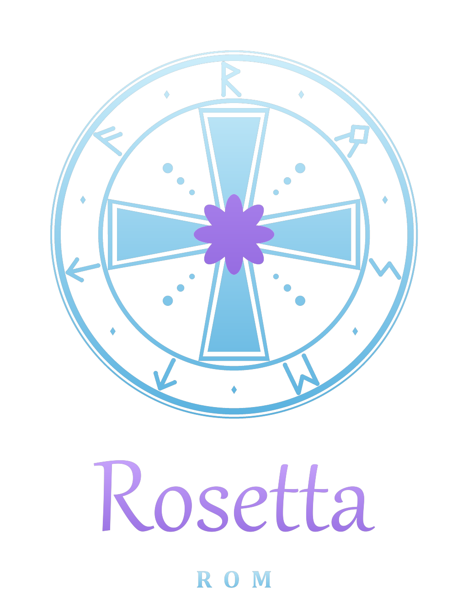

<p align="center"></p>

# Rosetta ROM: Roland D-110 custom samples mod (load your own sounds into the wave ROMs)

**Roland D-110 mod: load your own samples.** The PCM mask ROMs are swapped for flash, so the D-110 plays your
recordings: a sampler-style instrument where you record on your PC, burn, and play. The D-110 itself doesn't record. The new OS features (arp, sequencer, MIDI CC, wave sequencing) are in
[D-110 Rosetta OS](https://github.com/yuyoi/D110-rosetta-OS-v11).

> **Works on real hardware.** Custom samples play on a real Roland D-110 from SST39SF040 flash chips in IC7, IC8 and
> IC15. See [Status](#status-working-prototype-2026-10-06) for the setup and the wiring lessons.

Goal: give any rompler your own samples by replacing its PCM mask ROMs with flash chips (e.g. SST39SF040) programmed by an
ESP32, so your own samples play where the factory waves were. First target: **Roland D-110** (LA synthesis).

This is the next step after [U110 RomHex Studio](https://github.com/yuyoi/u110-romhex-studio) and the
[ESP32 maskrom programmer](https://github.com/yuyoi/esp32-maskrom-programmer) (U110 HexWizard).

## What works

- **Decode the D-110 wave ROMs** (IC8 = drums, IC7 = instruments): 16-bit log samples, two ROM bytes each. Round trip
  ROM -> audio -> ROM is bit-exact on the dumps used here. Decoded audio was checked by ear.
- **Read the sample table + names** from the control ROM (IC12): 4-byte entries `{pos, len/loop, pitch}`, wave names
  8 ASCII chars at `0x100 + 8*index`. Wave space is 1 MB: IC8 first, then IC7.

> **Chip names.** The dump files and most of the code call the 128 KB tone ROM `ic12`, following the romset naming.
> On the actual board it is **IC15** (LH5310-DJ); board IC12 is a TC74HC27P logic chip. Everything here means
> IC15 when it says IC12, unless it is explicitly talking about the dump filename or the manifest key.
- **Swap a wave** with a WAV (same slot position and length, no table edits) and **rename** it.
- **Rosetta ROM Studio** (`rosetta_studio.pyw`): U110-Studio-style GUI. Wave list, waveform (original vs replacement),
  load WAV, rename, save/open projects, import ROM dumps, import a folder of WAVs, export all originals, BUILD patched images.

## Open questions

- The pitch field of the table entries (tuning of a swapped wave is a guess; drums are fine, pitched waves may be off).
- Table entries beyond the first 128 (`0xB00+` block) and timbre names (10 chars from `0x1200`).
- The log-to-linear scale is matched to munt's description. Banks built with it play correctly on a D-110.

### Known limitation: what "decode check 1.0000" does and does not prove
Every `decode check` in a build report is a **Pearson correlation** between the decoded ROM samples and the
WAV you supplied. Pearson is invariant under a constant offset, and this codec has no exact zero:
`log_to_lin(0) == 1.0`. So every wipe, every pad and every parked ("freed") wave is written as a constant
`+1.0` rather than true digital silence — inaudible (about 0.0015% of full scale, and 1.09% of the samples in a
stock IC8 are already exactly log-0, which decodes to that same value), but **structurally invisible to the
number**. A 1.0000 correlation therefore does not prove bit-exactness; only `test_codec.py`'s ROM -> audio ->
ROM byte comparison does. Build reports now print the mean bias next to the correlation
(`decode check 1.0000, bias +0.2153`) so the strength is visible rather than implied.

## Use

You must supply your **own ROM dumps** (they are Roland's copyrighted data and are not in this repo):

```
dumps/r15179880.ic8.bin   512 KB drum PCM ROM
dumps/r15179878.ic7.bin   512 KB instrument PCM ROM
ctrl/<anything>/r15179873*.bin   128 KB control ROM (IC12)   (or File > Import ROM dumps in the Studio)
```

```
pip install numpy
python rosetta_studio.pyw            # GUI (Python 3.10, Windows; tkinter)
python rosetta_studio.pyw --selftest # headless build check
python rosetta_swap.py 3 kick.wav [NEWNAME]   # CLI swap of wave #3
```

BUILD writes `r15179880.ic8_patched.bin`, `r15179878.ic7_patched.bin` and (if you renamed) `r15179873.ic12_patched.bin`
plus `report.txt`. Images are in chip byte order, as dumped. Renaming needs IC12 reprogrammed too.

## Files

| File | |
|---|---|
| `rosetta_d110.py` | ROM <-> log <-> linear codec |
| `rosetta_studio.pyw` | GUI |
| `rosetta_swap.py`, `swap_ic8.py` | CLI swap tools |
| `probe_pcm.py`, `table_test.py`, `split_table.py`, `test_*.py` | analysis and tests used to work the format out |
| `CONTEXT.md` | working notes, findings and open questions |
| `mcs96_dis.py`, `test_mcs96_dis.py`, `mame_ref/` | MCS-96 disassembler + flow tracer for the D-110 OS ROM (IC19); test against MAME's disassembler |
| `IC12_MAP.md`, `IC19_MAP.md` | control ROM and OS ROM structure maps |
| `IC6_MAP.md` | the BOSS reverb chip's program ROM: what it is, and why it is not a Rosetta target |
| `patch_ic19.py` | patches your own IC19 dump (v1.10): `--banner` sets the version screen text, `--boot-banner` shows it at every power-on, `--plain-words` swaps TVA/TVF/WG... for plain labels |
| `ic19_quick.py` | Quick screen (Enter + Edit): cutoff/reso/attack/release for all partials, used by `patch_ic19.py --quick` |
| `mcs96_sim.py`, `test_ic19_quick.py` | small MCS-96 simulator (no I/O); runs the Quick screen on your patched dump |
| `patch_ic15.py` | puts new OS code into your own IC15 image (free area 0x1F000), called via `patch_ic19.py --ic15-hook` |

## Credits and legal

- **Made by JunkSmithWizard (JSW) together with Claude (Anthropic's AI).**
- Sample format, bit order and table structure follow the [munt](https://github.com/munt/munt) MT-32 emulator source (LGPL)
  and were then checked against D-110 dumps. No munt code is included.
- Roland, D-110, MT-32 and LA synthesis are trademarks of their owners. This project is not affiliated with Roland.
  No ROM data or decoded audio is distributed here.
- MIT licensed (see `LICENSE`).

logo: runic ring spells ROSETTA (Elder Futhark) round a cross pattee; the purple rosette is the "little rose" of the name, and the Rosetta Stone, the key between scripts. `python make_logo.py` regenerates `assets/`.

## Status: working prototype (2026-10-06)
Custom samples play on a real Roland D-110 from SST39SF040 flash in IC7, IC8 and IC15 (x4 image on IC15). Verified with a synthetic glitch bank,
organic/drum banks and a bank made from the author's own voice recordings (intelligible on the hardware).

Wiring lessons: lift SST pin 24 (OE#) clear of any pad and ground it separately; check every net with a continuity beeper; do not use two sets of
pin labels on one picture. Always read a chip first, write, read back and compare MD5.

Record-your-own workflow:
1. `rosetta_recorder.pyw`: hold SPACE to record a snip (mic -> 32 kHz mono, trimmed, normalised) into `recordings/NNN_label.wav`.
2. `py -3.10 gen_recorded_bank.py`: fills every wave slot with a take (or a reversed/crushed/sped-up variant), names each wave by what it
   sounds like, stretches long takes into small slots (S=2/4 with the pitch field lowered), writes IC8/IC7/IC15 burn files + `key.txt`.
3. Burn IC15, IC8, IC7 (`minipro -p SST39SF040 -w file`, verify by read-back), RAM-reset the D-110 so the new names load.
Needs your own ROM dumps (not included). Known limits: slots are 0.06-0.5 s so long takes are stretched (8 kHz bandwidth at S=4);
length codes 5-7 untested on hardware (see below); PN-D10-01 card shows "No Data" in the modded unit (cause unknown).

## Length codes: what is proven and what is not

A PCM table entry's length byte carries a 3-bit code `e`; the slot is `0x800 << e` samples at 32 kHz.

| e | slot | stock waves using it | verified |
|---|---|---|---|
| 0 | 0.064 s | 80 | yes, on hardware |
| 1 | 0.128 s | 80 | yes, on hardware |
| 2 | 0.256 s | 63 | yes, on hardware |
| 3 | 0.512 s | 27 | yes, on hardware |
| 4 | 1.024 s | 6 (bank-2 entries 222-227, looped) | stock precedent, never exercised by Rosetta |
| 5 | 2.048 s | 0 | **software only** |
| 6 | 4.096 s | 0 | **software only** |
| 7 | 8.192 s | 0 | **software only** |

`test_repack.py` proves that all eight codes allocate a legal, block-aligned slot and leave every table entry
in range; it does **not** prove the LA32 plays them. Nothing in v13 claims e=5..7 works on hardware until the
test below has been run once. A WAV longer than its slot is not silently padded: the Studio grows the slot when
it can, and when it cannot (e=7 is the ceiling) the `.rpatch` manifest records `truncation` and the injector
prints a warning naming the dropped seconds.

**Hardware procedure (once, ~20 min).** Burning a bank that uses e=5..7 risks nothing outside that bank - the
table entry is data, so a wrong guess sounds wrong but cannot brick the unit. Still, read every chip first and
verify MD5 on read-back as always.
1. Record or find one clean 2-4 s sample and one 4-8 s sample (mono, 32 kHz after import).
2. Load each into the Studio with every other wave's space freed, so the slot grows instead of the wave being cut.
   The build report prints the slot length in seconds - confirm it says `2.05 s` / `4.10 s` / `8.19 s`, not the shorter number.
3. Export `.rpatch`, inject it with `rosetta_inject.py` (the same way you would for any pack), burn IC15/IC8/IC7, RAM-reset.
4. Play the wave at its root key and then a few semitones up and down. Expect: plays from the right note, no click,
   no wrap-around into the neighbouring wave, and the full length plays before the note ends (or loops if looped).
5. Record the outcome here in the README. If e=5..7 work, delete the "software only" marks above and the open TODO.

Demo: `demo/d110_recorded_bank_all_waves.m4a` is a real D-110 playing waves 1-128 of the recorded bank in order, loops at the end.

## Building the exe
`build_exe.bat`, run from this folder. It needs Python 3.10 with `pyinstaller` and `numpy`:

    py -3.10 -m pip install -r requirements-exe.txt pyinstaller
    build_exe.bat

The build is reproducible: `rosetta_studio.spec` is committed, uses only relative paths (the old one hardcoded
`C:/Users/JUNKSMITHWIZARD/...` for the icon), and reads from a `--clean` work tree in `build_tmp/`. Output is
`dist/Rosetta ROM D110 v0.4.exe` — the name comes from `VERSION` in the spec, and the script **refuses to
overwrite**: bump `VERSION` for each build so an old known-good exe is always still on disk. `rosetta_inject.py`
is copied next to the exe rather than bundled into it; it is standard-library only, and the person running it
against their own ROM dumps should be able to read it.

Smoke test after every build: launch the exe from an empty folder. It must open to an empty wave list and say
so, not exit.

Dependencies are split: `requirements-exe.txt` is the whole Studio runtime (numpy, windnd); the generators,
recorder and audition tools need more (`requirements-generators.txt`: scipy, soundfile, sounddevice, mido,
pillow). `requirements.txt` is both.

## TODO
- [x] **Patch workflow (no Roland data in the repo):** done in v13 — the Studio writes `.rpatch` packs
  (File > Export .rpatch pack), `rosetta_inject.py` applies one to the user's OWN IC15/IC7/IC8 dumps, gates on
  the revision, tiles IC15 4x for the SST39SF040 and writes the three burn files. `test_rpatch.py` proves a
  pack + inject is byte-identical to a direct build.
- [ ] Built-in noise pack preset (pink/white noise, buzz loops, noise drums; from `gen_glitch_bank.py`) as one of those patches.
- [ ] PN-D10-01 ROM card shows "No Data" in the modded unit: test the card in a GR-50.
- [ ] Length codes 5-7 (samples longer than 1.02 s without the stretch trick) verified in software, untested on hardware. Procedure above.
- [x] Reproducible exe build (`build_exe.bat` + committed spec). Current build: `dist/Rosetta ROM D110 v0.4.exe`.
- [ ] OS mod: check that the stock Write/Copy > "Timbre Write" saves Quick-screen/CC edits (they go into the same timbre temp area the stock editor uses; the edited flags only drive the `*` marker). Resonance etc. belong to the timbre, not the patch: write the timbre to an I-slot, point the patch part at it, then Patch Write.

## D-110 OS mod v6: one EPROM swap (IC19 only)
The non-intrusive upgrade: one socketed chip, stock IC15/IC7/IC8, put the original back any time. v6 code =
commit `df82c2a` (the tools only change with a new version number). Bigger features that need IC15 come as a separate two-chip mod.

Works on a real D-110 (OS v1.10). It only changes IC19, the socketed OS EPROM, and works with a stock IC15/IC7/IC8.
- **Quick screen:** hold **Enter** + press **Edit** (this used to start the demo). Group +/- = filter cutoff,
  Bank +/- = resonance, Number +/- = attack, Part +/- = release. Each step moves all 4 partials of the current part.
  Part (plain button) = next part P1..P8. Exit = back. Cutoff and resonance change held notes live; attack/release
  apply from the next note. Cutoff/resonance only affect synth partials (SQU/SAW), not PCM.
- **MIDI CC knobs** (`--cc`, works on hardware): CC74 cutoff, CC71 resonance, CC73 attack, CC72 release,
  per part on its MIDI channel. Cutoff/resonance move held notes live, like the Quick screen. Other numbers:
  `--cc 74,71,73,72` order cutoff,reso,attack,release (only CCs the stock OS ignores).
- **Plain words:** WG/P-ENV/P-LFO/TVF/TVA... become OS/Pitch/Vibr./Flt/Amp...
- **Boot banner:** your own 2 x 16 characters at power-on.

**Legal:** this repo contains no Roland code. You read **your own** IC19 and the tool adds the new bytes to your dump.
Please don't share the patched .bin: share this repo instead.

1. Read your IC19 (27C256-type EPROM, e.g. M5M27C256K) on a programmer such as a T48 (27C256 profile) and save it
   as `ctrl/ic19.bin`. Keep the original chip.
2. Patch it (the tool refuses anything that is not the v1.10 dump, SHA-1 `28635510...`):
   ```
   python patch_ic19.py ctrl/ic19.bin -o ctrl/ic19_mod.bin --quick --cc --plain-words --boot-banner --banner-time 15 --banner " D-110  ROSETTA " "  your text     "
   ```
   Any option can be left out. `python test_ic19_quick.py ctrl/ic19_mod.bin` runs the Quick screen in a simulator
   first.
3. Burn `ic19_mod.bin` to a blank 27C256 (UV EPROM such as M27C256B; erase it under UV first), read it back and
   compare, then fit it in IC19 (notch the same way).
4. If anything looks wrong, put the original chip back.

Details: `IC19_MAP.md` ("Stage 3", "Quick screen"). Code: `patch_ic19.py`, `ic19_quick.py`.

## Disassembling the OS ROM (IC19)
IC19 (32 KB, socketed) holds the 8097 program. With your own dump in `ctrl/ic19.bin` (gitignored):
```
python mcs96_dis.py ctrl/ic19.bin -o ctrl/ic19.lst     # listing: traced code, jump tables, data
python mcs96_dis.py ctrl/ic19.bin --summary            # vectors, code/data map, I/O and RAM references
sh mame_ref/build.sh && python test_mcs96_dis.py       # optional: check the decoder against MAME
```
The listing is derived from Roland's code: keep it private. Findings so far: `IC19_MAP.md`.

## Reading your own IC15 (the LH5310 control ROM)
IC15 is a 28-pin DIP LH5310-DJ mask ROM (128 KB, board designator IC15; the dump set calls it "ic12"). Pinout, top view: A15 1, A12 2, A7 3, A6 4, A5 5, A4 6, A3 7, A2 8, A1 9, A0 10, D0 11, D1 12, D2 13, GND 14, D3 15, D4 16, D5 17, D6 18, D7 19, /OE 20, A10 21, A16 22, A11 23, A9 24, A8 25, A13 26, A14 27, Vcc 28. Note A16 sits on pin 22, where a 27C256 has OE#, and /OE on pin 20, where a 27C256 has CE#, so a plain 27C256 profile does not work without an adapter or jumper.
- Read on a T48 with `minipro -p <profile> -x -r ic15.bin` (`-x` skips the chip-ID check, mask ROMs have none) and compare against the known revision before patching.
- TODO (author to fill in): exact socket/adapter and jumper wiring used to read it, and which T48 profile.
